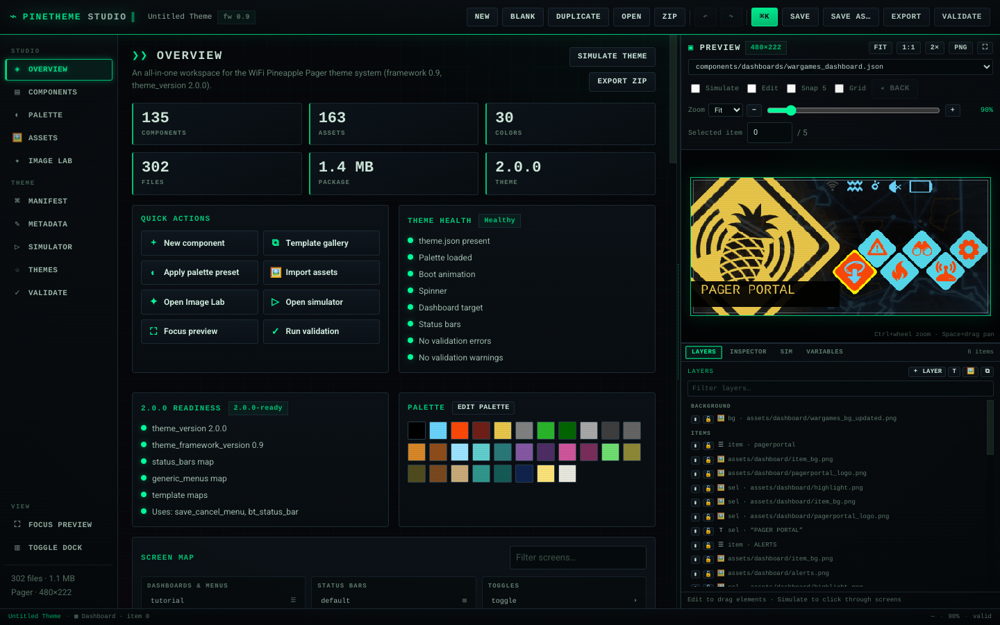

# PineTheme Studio

An all-in-one, open-source theme studio for the **Hak5 WiFi Pineapple Pager**.
Create, edit, preview and package Pager themes (framework 0.9 / `theme_version`
`2.0.0`) without hand-editing JSON or juggling image files.

Built with Electron. Everything runs offline. The core editor, ZIP engine,
renderer, validators and image pipeline are plain JavaScript in `src/`, with a
vendored advanced image editor for heavier compositing work.




---

## Why this exists

The official Pager theme system is powerful but JSON-heavy: a theme is a web of
component files, palette names, asset paths, template maps and target bindings.
PineTheme Studio gives that system a real IDE:

- a **pixel-accurate 480 × 222 preview** that no longer gets clipped,
- a **resizable dock** with fit / 1:1 / 2× / 3× / 6× zoom, wheel zoom and
  space-drag panning,
- **direct manipulation** on the canvas (drag, multi-select, snap, nudge,
  reorder, hide/lock layers),
- an **Image Lab** tuned for tiny Pager assets (dithering, thresholding,
  palette quantization, crop/resize, outlines, shadows),
- **2.0.0 schema coverage** for the fields community themes actually use.

---

## Feature tour

### Studio workspace

- **Resizable three-pane layout** — drag the divider between the editor and the
  preview dock. The width is remembered between sessions. Double-click the
  divider to reset it.
- **Focus preview (F)** — hides the rest of the UI and gives the preview the
  whole window. `Esc` returns.
- **Dock tabs** — Layers, Inspector, Sim and Variables share the lower dock, so
  the canvas gets the space it needs.
- **Overview dashboard** — component/asset/color counts, package size, theme
  health, a **2.0.0 readiness** card, a palette strip, a filterable screen map and
  quick actions.
- **Command palette (Ctrl+K)** — jump to any component, asset, palette color or
  screen, or run studio commands from the keyboard.
- **Status bar** — theme, current screen, selection coordinates, zoom and
  validation state at a glance.

### Preview and simulation

- **Pixel-for-pixel 480 × 222 renderer** with:
  - background layers, background colors and `background_path` screens,
  - menu items with per-item layers and `selected_layers`,
  - multi-page screens, keyboard rows (`qwerty`, `QWERTY`, `symbols`),
  - boot/spinner animation frames and item animation frames,
  - status bars, including Bluetooth bars and per-item states,
  - string / toggle / radio / signal templates,
  - `recolor_palette`, direct `recolor_rgb` tints and `text_color` aliases,
  - multi-line and wrapped text (`max_chars`, `wrap_text`, `max_lines`),
  - `center_text_within`, `save_cancel_menu`, payload-log indicators and more.
- **Simulation mode** — click a menu item to follow its `target`:
  `generic_menus` jumps, `next_page` / `previous_page`, `goto <id>`,
  `inline_toggle`, `back` / `cancel` / `close`, plus a back stack.
- **Full simulator panel** — D-pad / A / B buttons honor each screen's
  `button_map`, history, status-bar state selectors and live variables.
- **Variable editor** — set sample `$_VAR` values and see them render live.
- **Status state control** — preview battery/volume/brightness/vibrate states.

### Visual editing

- **Drag and multi-select** — click, Shift-click, drag selections, and move
  groups. Optional 5 px snapping and a grid overlay.
- **Arrow-key nudging** — 1 px; Shift+Arrow for 10 px.
- **Layers panel** — eye (hide from preview), lock, reorder via ↑/↓ or drag,
  duplicate, delete, add text/image layers. Hidden/locked state never changes
  the exported theme.
- **Inspector** — every common layer and item field: X/Y, image, recolor palette
  and RGB, text, variable, text size, template, max chars/lines, wrapping,
  centering box, target, button map, selected/unselectable, animation interval.
- **Screen inspector** — edit `screen_name`, `status_bar`, `windowed_canvas`,
  `cache_canvases`, `refresh_interval`, `visible_lines`, `title_x/y` and
  background color without touching JSON.
- **Context menu** — duplicate, copy, paste, delete, reorder, select parent item,
  add layers, open the component JSON.
- **Undo / redo** — 80 steps across palette, metadata, layout, component and asset
  changes.

### Component studio

- Browse all components with a type badge and a `theme.json` reference marker.
- **Template gallery** with generators for dashboards, lists, dialogs, alerts,
  status bars, keyboards, animations, text/toggle/radio/signal templates,
  splash screens and recon graph configs.
- Create, duplicate, rename (updating every reference), delete, import and
  export components.
- Structured form or raw JSON; `Ctrl+Enter` applies JSON.
- Open the current component in the preview or simulator with one click.

### Manifest studio

- `theme.json` is presented as **sections**: identity, status bars, generic
  menus, templates, option dialogs, dialogs/alerts, core surfaces, recon,
  keyboards, Pager Portal, images and other keys.
- Every path field has a component/asset picker and an **Open** action.
- Add new map bindings without editing JSON.
- Raw JSON mode retains Format / Reload / Apply and `Ctrl+Enter`.
- Metadata edits write through to `theme.json` and the generated `README.md`.

### Palette tools

- Edit all palette colors with pickers and hex fields; add, remove, import,
  export, sort by luminance or hue, and reset to the default warGames palette.
- **Contrast checker** with WCAG AA / AAA ratios.
- **Harmony generator** — complementary, split, analogous, triadic, tetradic,
  monochrome and shades.
- **Palette extraction** — median-cut color extraction from any image.
- **Starter presets** — WarGames, Amber CRT, Cyberpunk, DMG and Mono.

### Image Lab

A focused, offline image pipeline for Pager assets:

- Crop/resize with contain, cover or stretch; nearest-neighbor by default.
- Rotate 90°, flip H/V, trim transparent bounds.
- Brightness, contrast, saturation, hue, gamma, alpha cutoff, invert, grayscale.
- **Pagerize** modes: threshold (1-bit), Floyd–Steinberg, Atkinson, Bayer 4×4,
  Bayer 8×8, nearest-palette remap and palette + Bayer dither.
- Palette-aware dark/light colors and optional force-to-palette-color.
- Outline, drop shadow and tint effects.
- Checkerboard preview, fit/100%/200% zoom and a hold-for-before button.
- Apply back to the asset, save as a new asset, or export PNG.
- Standard size presets: 480×222, 33×29, 63×62, 71×72, 20×20, 220×156,
  400×180 and 44×28.
- **Advanced editor** — a vendored [Toast UI Image Editor](https://github.com/nhn/tui.image-editor)
  (MIT) opens in an isolated local frame for freeform crop, draw, shapes, text,
  masks and filters. “Use result” sends the image back to the Image Lab.

### Assets

- Lazy thumbnails with dimensions, size and reference counts.
- Filter, sort by path/size/usage/dimensions.
- Import (button or drag-and-drop), replace, rename with reference updates,
  delete, delete all unused.
- **Find usages** across `theme.json` and components.
- **Open in Image Lab** from the inspector or asset grid.
- **Asset inspector** with a large preview and usage list.

### Theme library

- Scan a local clone of
  [`hak5/wifipineapplepager-themes`](https://github.com/hak5/wifipineapplepager-themes)
  or any folder of themes.
- Cards show version, framework, component/asset counts, author, palette swatches
  and path.
- Open a theme or clone it as a new working copy.
- Recent themes are remembered locally.
- Works with the repo root or a `themes/` directory.

### Validation

- `theme.json` presence, JSON validity, version/framework fields.
- Palette shape and range checks.
- Every referenced component **and asset** path in `theme.json`.
- Component JSON validity, missing images, undefined palette names,
  `text_color` aliases and `recolor_rgb` ranges.
- Undefined status bars and Bluetooth status bars.
- Case-insensitive filename collisions.
- Boot animation / spinner presence.
- Non-fatal info: unused assets, repeated item IDs, missing optional metadata and
  large package size.
- Results have **Open** actions that jump to the right editor; export warns
  before shipping errors.

### Packaging

- Save to a folder or export a ZIP (verified by the test suite).
- Generated `README.md` with name, author, version, framework, description and
  install instructions.
- Duplicate the current theme as a new copy.
- Start from the bundled official `wargames` theme or a minimal blank theme.

---

## Keyboard shortcuts

| Shortcut | Action |
| --- | --- |
| `Ctrl/Cmd + K` | Command palette |
| `Ctrl/Cmd + S` | Save |
| `Ctrl/Cmd + Shift + S` | Save as |
| `Ctrl/Cmd + E` | Export ZIP |
| `Ctrl/Cmd + O` | Open folder |
| `Ctrl/Cmd + Z` | Undo |
| `Ctrl/Cmd + Shift + Z` / `Ctrl+Y` | Redo |
| `Ctrl/Cmd + C / V / D` | Copy / paste / duplicate selection |
| `Delete` | Delete selection |
| Arrow keys | Nudge 1 px |
| Shift + Arrow | Nudge 10 px |
| `0` | Fit preview |
| `1` / `2` | 100% / 200% preview |
| `+` / `-` | Zoom in / out |
| `F` | Focus preview |
| `Esc` | Close modal / clear selection / leave focus |
| `Ctrl/Cmd + wheel` | Zoom preview at pointer |
| `Space` + drag | Pan preview |
| `Ctrl/Cmd + Enter` | Apply JSON in editors |
| `Shift` + click | Add to selection |
| `Shift` + drag a menu item | Move the whole item |

---

## Install and run

### Requirements

- Node.js 18+ (20+ recommended)
- Linux, macOS or Windows with a graphical display
- `npm`

### From source

```bash
git clone https://github.com/sinXne0/pinetheme.git
cd pinetheme
npm install
npm start
```

### `pgt` launcher and desktop entry

```bash
./packaging/install-desktop.sh
```

This installs `~/.local/bin/pgt`, a desktop entry and an icon. Launch **PineTheme
Studio** from your app menu or run `pgt`.

### Tests

```bash
npm test
```

The suite boots the real Electron renderer against the bundled reference theme
and exercises colors, preview rendering, simulation, drag editing, undo/redo,
palette import/export, PNG export, ZIP round-tripping, component/asset CRUD,
reference updates, validation and blank-theme scaffolding.

---

## Theme format notes (2.0.0 / framework 0.9)

A theme is a directory containing:

```text
my-theme/
├── assets/
├── components/
├── theme.json
└── README.md
```

`theme.json` wires named surfaces to component files: status bars, generic menus,
dashboards, dialogs, keyboards, templates, recon lists, Pager Portal screens,
alerts, lock screen, spinners and more. `color_palette` maps color names to
`{r,g,b}` values. Components are layered JSON screens.

PineTheme Studio understands the additions used by the 2.0.0 reference and
community themes, including:

- `recolor_rgb` and `text_color`
- `radio_template`, `save_cancel_menu`, `scrolling`/payload-log indicator arrays
- `bt_status_bar`, `title_x` / `title_y`
- `refresh_interval`, `visible_lines`, `default_text_color`, `error_text_color`
- `failsafe_duckyscript_list_picker`, `fallback_menu`, `theme_name`
- uppercase `QWERTY` and `symbols` keyboard screens
- item `selected`, `unselectable`, `animation`, `animation_interval` and
  `button_map`

The bundled `reference/wargames` theme is the 2.0.0 known-good scaffold used by
**New theme**.

---

## Architecture

```text
src/
├── index.html          studio shell
├── styles.css          layout and visual language
├── app.js              state, panels, preview interaction, library, command palette
├── model.js            theme file map + parsed helpers
├── palette.js          color math, contrast, harmonies, median-cut extraction
├── preview.js          480×222 layered canvas renderer
├── imagelab.js         crop/resize/grade/dither/palette/effects pipeline
├── templates.js        component generators, manifest metadata, presets
├── validators.js       theme validation
├── zip.js              dependency-free ZIP read/write
├── advanced-editor.html / advanced-editor.js
└── vendor/tui/         vendored Toast UI Image Editor + color picker (MIT)
```

Runtime dependencies: none beyond Electron. Everything else is bundled or plain
JavaScript.

---

## Credits and open source

PineTheme Studio is an independent, unofficial community tool. WiFi Pineapple,
Pineapple Pager and Hak5 are trademarks of Hak5 LLC.

- **Toast UI Image Editor** and **tui-color-picker** — MIT, NHN Cloud. Vendored
  for the optional advanced editor; Fabric.js is bundled inside the Toast UI
  distribution (MIT).
- **Palette/dithering algorithms** — implemented in-house based on the public
  Floyd–Steinberg, Atkinson and Bayer ordered-dithering algorithms.
- The official theme format is defined by
  [`hak5/wifipineapplepager-themes`](https://github.com/hak5/wifipineapplepager-themes).
  The bundled `reference/wargames` theme is used as a known-good scaffold and
  remains the property of its authors.

If you use or adapt this studio, credit the project and the upstream theme
format. Community themes and assets keep their original authors' rights.

---

## License

MIT. See [LICENSE](LICENSE).
