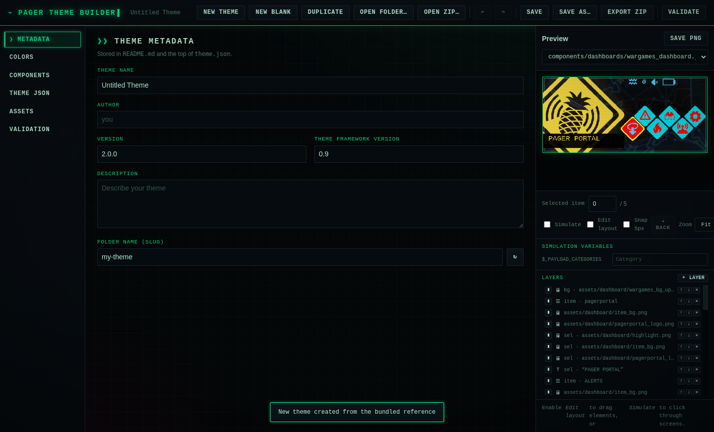

# Pager Theme Builder

A free, open-source desktop GUI for creating and customizing themes for the
**Hak5 WiFi Pineapple Pager** — a local alternative to the paid Theme Studio Pro.

Built with Electron. Everything runs offline, and the app has **zero runtime
dependencies** beyond Electron itself: ZIP reading/writing, theme parsing and
validation are implemented in plain JavaScript in `src/`.




---

## Features

- **Full color palette editing** — edit all 30 named palette colors with a color
  picker or hex field, add new colors, remove unused ones. Import or export a
  palette as JSON, or reset to the default palette. Changes appear in the live
  preview immediately.
- **Pixel-for-pixel live preview** of the Pager's 480 × 222 screen, rendered with
  the same layered model the firmware uses:
  - absolute background layers
  - menu items with per-item relative layers and `selected_layers`
  - status bars
  - string / toggle / radio / signal templates, including each template state
  - `recolor_palette` image tinting
  - multi-page screens, multi-screen components, and boot-animation frames
  - multi-line / wrapped text using `max_chars`, `wrap_text`, and `max_lines`
  - keyboard input areas and image-only screens (update checker, etc.)
- **Interactive simulation** — enable *Simulate* and click a menu item to follow
  its `target`: jump to a `generic_menus` screen, navigate pages, follow
  `goto <id>`, toggle inline toggles, and go **Back** through a screen stack.
- **Variable editor** — set sample values for `$_VAR` template variables (SSIDs,
  names, descriptions, battery, etc.) and see them render live; toggle and
  checkbox templates switch between their enabled/disabled states.
- **Drag-and-drop layout editing** — enable *Edit layout*, then drag any element
  to move it. Hold **Shift** while dragging a menu item to move the whole item
  (all of its layers) instead of one layer. Arrow keys nudge the selection by
  1 px (Shift + arrow moves the whole item). Optional **Snap 5px** aligns dragged
  elements to a 5 px grid, and a live coordinate readout shows the pointer
  position on the 480 × 222 canvas.
- **Layers panel** — a Photoshop-style list of every background layer and menu
  item (with its unselected/selected layers). Click to select, toggle an eye to
  hide a layer from the preview (still exported), reorder with ↑/↓, delete with
  ✕, or add a new layer with **＋ Layer**.
- **Properties inspector** — edit the selected layer or item precisely: X/Y
  position, image (with an asset picker), recolor/text palette, text content,
  text size, and template variable. Selection stays in sync between the canvas
  and the layers panel.
- **Undo / redo** — every palette, metadata, layout, component and asset change
  is undoable (up to 80 steps). Use the toolbar buttons or Ctrl+Z / Ctrl+Shift+Z.
- **Dirty-state protection** — switching themes or closing the window asks
  before discarding unsaved changes.
- **Component JSON editor** — browse all components, edit the raw JSON, apply it
  (button or **Ctrl+Enter**), and preview that component directly. Invalid JSON
  is rejected with an error.
- **Component management** — create, duplicate, rename and delete components
  from the Components tab. Renaming updates every path reference in
  `theme.json` and other component files; deleting warns when references remain.
  Import a component from a `.json` file or export the selected component.
- **Raw `theme.json` editor** — edit the manifest directly with **Format**,
  **Reload** and **Apply** (or **Ctrl+Enter**). Unsaved edits survive tab
  switches and are validated before they replace the live manifest.
- **Asset management** — browse every asset with lazy thumbnails, filter by
  name, see dimensions, file size and how many times it is referenced, import
  images (button or drag-and-drop), replace an existing image, rename an asset
  (updating every reference), delete selected assets, or delete all unused
  assets in one step. Importing a file with an existing name replaces it.
- **Save a preview PNG** — export the current 480 × 222 preview for docs or
  sharing.
- **Validation** — checks `theme.json`, palette values, referenced component
  files, referenced assets, undefined palette names, and case-insensitive path
  collisions. A sidebar badge shows the problem count, each result has an
  **Open** action that jumps to the relevant editor, and export warns before
  producing a package with validation errors.
- **Duplicate theme** — clone the current theme in memory as a new copy so you
  can experiment without touching the original.
- **Export a valid theme package** — Save to a folder, or export a ZIP that is
  verified against the official reference theme's file set.
- **Start from the official `wargames` theme** — 301 files are bundled as a
  known-good scaffold, so a new theme is always structurally valid. **New blank**
  creates a minimal `theme.json` + palette theme when you want to start from
  scratch.
- **One-command launcher** — `pgt` on your PATH, plus an optional desktop entry
  and icon.

---

## Requirements

- **Node.js 18+** (Node 20+ recommended)
- Linux, macOS or Windows with a graphical display
- `npm` (comes with Node)

Electron is installed as a dev dependency, so no global install is required.

---

## Install and run

### From GitHub

```bash
git clone https://github.com/sinXne0/pinetheme.git
cd pinetheme
npm install
npm start
```

The app is Electron-based and installs everything it needs via `npm install`
(Electron is the only dev dependency). No global install is required.

### `pgt` launcher and desktop entry

Install a launcher on your PATH and a desktop-menu entry:

```bash
./packaging/install-desktop.sh
```

That script:

- writes `~/.local/bin/pgt`
- installs an icon under `~/.local/share/icons/`
- writes `~/.local/share/applications/pgt-theme-builder.desktop`

Then run:

```bash
pgt          # launch the app
pgt --dev    # launch with DevTools
```

If `~/.local/bin` is not on your `PATH`, add this to your shell config:

```bash
alias pgt="$HOME/.local/bin/pgt"
```

Useful scripts:

| Command | What it does |
| --- | --- |
| `npm start` | Launch the app |
| `npm run dev` | Launch with DevTools open |
| `npm test` | Run both end-to-end tests |
| `npm run test:smoke` | Boot test: loads the reference theme and verifies the UI/preview |
| `npm run test:interaction` | Exercises color preview, drag, undo/redo, assets, palette/PNG export, validation, ZIP export |
| `./packaging/install-desktop.sh` | Install the `pgt` launcher, icon and desktop entry |

> On a headless Linux box, run the tests under Xvfb:
> `xvfb-run -a npm test`.

---

## Quick start

1. Launch the app. It automatically creates an **Untitled Theme** by cloning the
   bundled `wargames` reference theme. Use **New blank** if you prefer to start
   with only `theme.json` and a default palette.
2. Open **Metadata** and set the theme name, author, version and description.
3. Open **Colors** and adjust the palette. The preview updates as you pick colors.
   Use **Import palette…**, **Export palette…**, or **Reset to default** as needed.
4. Use the **Preview** panel on the right:
   - choose a component from the dropdown
   - choose a screen/variant, page, or animation frame when available
   - enable **Edit layout** and drag elements (Shift-drag moves a whole item)
   - optionally enable **Snap 5px** for grid-aligned dragging
   - use the arrow keys to nudge by 1 px
   - switch **Zoom** to **Fit** to scale the preview to the panel
   - click **Save PNG** to export the current preview
5. Open **Components** to create, duplicate, rename or delete components, or
   open **Theme JSON** for direct manifest editing. **Validation** badges and
   **Open** actions help you jump straight to broken references.
6. Open **Validation** and run it. Fix any errors before exporting.
7. Click **Save** / **Save as…** to write a theme folder, or **Export ZIP** to
   create a distributable archive.

### Keyboard shortcuts

| Shortcut | Action |
| --- | --- |
| `Ctrl+S` | Save |
| `Ctrl+Shift+S` | Save as… |
| `Ctrl+E` | Export ZIP |
| `Ctrl+O` | Open theme folder |
| `Ctrl+Z` | Undo |
| `Ctrl+Shift+Z` / `Ctrl+Y` | Redo |
| `Ctrl+Enter` | Apply the JSON editor (component or theme.json) |
| Arrow keys | Nudge selected element by 1 px |
| `Shift` + arrow | Nudge the whole menu item |

### Preview controls

| Control | Purpose |
| --- | --- |
| Component dropdown | Select any of the theme's 135 components to preview |
| Screen | Pick a variant when a component contains multiple screens, template states, keyboard layouts, or image-only states |
| Page | Pick a page for paginated screens |
| Frame | Pick a frame for boot animations |
| Selected item | Highlight a specific menu item's selected state |
| Edit layout | Click to select, drag to move |
| Simulate | Click menu items to follow targets and navigate screens |
| Back | Return to the previous simulated screen |
| Variables | Edit sample values for `$_VAR` template variables |
| Snap 5px | Align dragged elements to a 5 px grid |
| Layers | Select, hide, reorder, delete or add layers/items |
| Properties | Edit X/Y, image, palette, text and size of the selection |
| Zoom | 1x / 1.5x / 2x / 3x, or **Fit** to scale to the panel |
| Coordinate readout | Shows the pointer position in canvas pixels |
| Save PNG | Save the current 480 × 222 preview as a PNG |

---

## Installing a theme on the Pager

Themes live in `/root/themes/<theme-name>/`. Do **not** edit files under
`/lib/pager/themes/` — that is the read-only stock location, and changes there
are ignored or overwritten.

### From a saved folder

```bash
scp -r my-theme root@<pager-ip>:/root/themes/
```

Or on the Pager itself:

```bash
cp -r /path/to/my-theme /root/themes/mycooltheme
```

### From an exported ZIP

```bash
scp my-theme.zip root@<pager-ip>:/root/themes/
ssh root@<pager-ip>
cd /root/themes
unzip my-theme.zip -d mycooltheme
```

The folder you install must contain `theme.json` at its top level:

```
/root/themes/mycooltheme/
├── theme.json
├── README.md
├── assets/
└── components/
```

Then select the theme on the Pager under **Settings → Display → Theme** (or
reboot if the theme list does not refresh).

---

## Project layout

```
pinetheme/
├── main.js                 Electron main process + IPC (open/save dialogs)
├── preload.js              Safe window.api bridge
├── src/
│   ├── index.html          UI structure
│   ├── styles.css          Dark UI styling
│   ├── app.js              UI controller, drag editing, save/export
│   ├── model.js            ThemeModel: file map, palette, component cache
│   ├── preview.js          Canvas renderer for the 480×222 screen
│   ├── palette.js          Default palette + color helpers
│   ├── validators.js       Theme validation
│   └── zip.js              Dependency-free ZIP writer/reader
├── reference/wargames/     Bundled known-good reference theme (301 files)
├── packaging/
│   ├── pgt.in              `pgt` launcher template
│   ├── icon.svg            Desktop icon
│   ├── pgt-theme-builder.desktop.in  Desktop entry template
│   └── install-desktop.sh  Installs the launcher, icon and desktop entry
└── test/
    ├── smoke.js            Boot / render / UI smoke test
    └── interaction.js      End-to-end editing and export test
```

### How edits are stored

All files are kept in memory as a flat `Map` of path → base64. Parsed component
objects are cached so drag edits can mutate them directly; `flushComponents()`
writes those objects back to the file map before save, export or validation.
This means a drag edit is persisted even if you never open the component JSON
editor.

Undo history stores shallow snapshots of that file map. File entries are
immutable, and `flushComponents()` leaves unchanged entries alone, so snapshots
stay cheap even for a 300-file theme. Undo/redo restores the snapshot and
refreshes the UI and preview.

### ZIP format

Exports use the ZIP **STORE** method (no compression — theme assets are mostly
PNGs, which are already compressed). The writer emits standard local headers,
a central directory and an end-of-central-directory record with CRC-32 checksums.
Opening a ZIP supports both STORE and DEFLATE (via the browser's
`DecompressionStream`).

---

## Validation checks

- `theme.json` exists and is valid JSON
- `theme_version` / `theme_framework_version` are present
- every palette entry is `{r,g,b}` with values 0–255
- every component referenced by `theme.json` exists
- every component JSON parses
- every `image_path` referenced by a component exists in `assets/`
- palette names referenced by components are defined
- files that differ only by case are flagged (Windows/macOS collisions)
- boot animation / spinner components are present
- at least one asset exists

---

## Limitations

- The preview is an approximation of the firmware renderer. Fonts and exact
  glyph metrics differ from the Pager, and some firmware-drawn widgets (for
  example clock text and a few specialized screens) are simplified. Text
  wrapping honors `max_chars` / `wrap_text` / `max_lines` but uses a monospace
  font.
- Keyboard previews render each key layout plus a sample `input_area`; typing
  into the preview is not simulated.
- Theme metadata (name/author/description) is stored in `README.md`; version and
  framework version are also written to `theme.json`. The Pager itself does not
  read a theme name from `theme.json`, so the installed folder name is what you
  will see in the theme list.
- A **New blank** theme contains only `theme.json` and `README.md`. Add the
  components and assets it references before installing it on the Pager.
- Renaming a component rewrites path references in `theme.json` and component
  JSON files, but does not rewrite unrelated `screen_name` values or action
  target strings. Deleting a component leaves its references in place so you can
  repoint them; validation will flag them.
- The app is not code-signed. On macOS/Windows you may need to allow it to run
  the first time.

---

## Tests

The tests boot a real hidden Electron window and drive the actual UI:

```bash
npm run test:smoke
npm run test:interaction
```

`test:interaction` verifies, among other things:

- 30 palette colors, 135 components and 163 assets load
- palette edits change the rendered canvas
- recolored images are re-tinted after a palette change
- text wrapping and explicit newlines behave correctly
- template-state, keyboard-input and image-only preview variants are detected
- `$_VAR` sample values can be overridden and render live
- simulate mode follows `generic_menus` targets and pushes a back stack
- undo/redo works through the toolbar and Ctrl+Z / Ctrl+Shift+Z
- palette JSON import validates colors and rejects non-object data
- palette export writes a 30-color JSON file
- preview PNG export writes a valid 480 × 222 PNG
- dragging moves a layer by exactly the drag delta and persists to the file map
- arrow-key nudging moves by 1 px
- the layers panel lists layers/items; selecting, editing X/Y in the inspector,
  toggling visibility, and deleting a layer all work
- **Fit** zoom scales the canvas and the coordinate readout reports canvas pixels
- **Snap 5px** is off by default and aligns dragged elements to the grid
- image import adds an asset and updates the grid
- dragging an image file onto the asset grid imports it
- selecting an asset shows its reference/usage count
- the raw `theme.json` editor applies valid JSON, rejects invalid JSON, and
  reloads the live manifest; Ctrl+Enter applies too
- the validation badge appears for problems and clears when they are fixed
- component create, duplicate, rename (with reference updates) and delete work
- component import, Ctrl+Enter apply and export work
- asset rename updates references, unused assets are flagged and bulk-deleted
- case-insensitive path collisions are reported
- duplicate-theme clones the current theme in memory
- validation reports 0 errors / 0 warnings for a cloned reference theme
- the exported ZIP passes the system `unzip -t` integrity check, re-opens with
  the built-in reader, and contains the expected files
- animation-frame and multi-page controls change the preview
- reloading a theme clears stale image caches
- **New blank** creates a two-file theme with the default palette

---

## License

MIT for the application code. The bundled `reference/wargames` theme is property
of Hak5 LLC and is included only as a known-good reference/scaffold for building
themes for the WiFi Pineapple Pager. This project is not affiliated with or
endorsed by Hak5.
